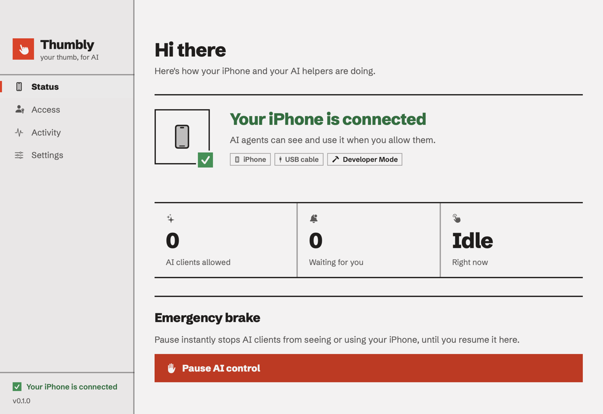
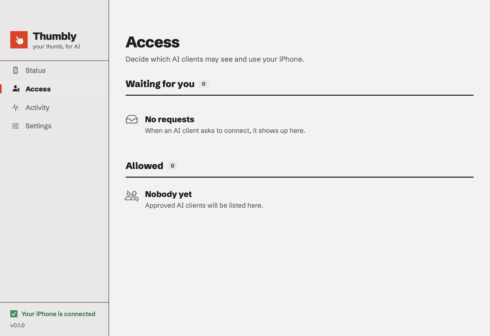

<div align="center">


# Thumbly

**Let AI agents see and control your iPhone from your Mac.**

[](https://github.com/timurcatakli/thumbly/actions/workflows/ci.yml)
[](https://github.com/timurcatakli/thumbly/releases)
[](#license)
[](#requirements)
[](#requirements)
[](https://modelcontextprotocol.io)
[](CONTRIBUTING.md)

[Install](#install) · [Quick start](#quick-start) · [Docs](docs/index.mdx) · [Contributing](#contributing) · [Changelog](CHANGELOG.md)

<picture>
  <source media="(prefers-color-scheme: dark)" srcset=".github/assets/status-dark.png">
  
</picture>

</div>

Thumbly connects your Mac to your iPhone over USB (or Wi-Fi after the first USB pairing) through
Apple's CoreDevice services. It gives AI agents native screenshots, touch, a virtual keyboard,
hardware buttons, and app and device information over [MCP](https://modelcontextprotocol.io).
You approve every client and keep control from the Thumbly Mac app. It needs no jailbreak and
no cloud relay, and it records no video.

## Features

- 📸 **See**: native screenshots and full-page captures of scrolling screens.
- 👆 **Act**: tap, swipe, long press, type, paste, hardware buttons, deep links and app launch.
- 🤖 **MCP-native**: works with Claude Code, Claude Desktop and any MCP client, plus Claude.ai
  and ChatGPT through [remote access](docs/remote-access/index.mdx).
- 🔐 **Owner in control**: you approve each client, see every action in the activity log, and
  can stop all AI control with one **Pause** button.
- 🧩 **App profiles**: deep links and step-by-step workflows that help agents work inside
  popular apps.
- 🐍 **Python SDK**: script the iPhone with [`thumbly-sdk`](packages/sdk-python).
- 🧪 **Simulator**: `thumbly serve --simulate` lets you develop without an iPhone.

## How it works

```
┌──────────────┐   MCP (HTTP)   ┌────────────────────┐   CoreDevice    ┌────────┐
│  AI agent    │ ─────────────▶ │  Thumbly service   │ ──────────────▶ │ iPhone │
│ Claude, etc. │ ◀───────────── │  (launchd, Python) │   USB / Wi-Fi   │        │
└──────────────┘                └─────────┬──────────┘                 └────────┘
                                          │ owner API (loopback)
                                ┌─────────▼──────────┐
                                │  Thumbly Mac app   │  approve · watch · pause
                                └────────────────────┘
```

## Requirements

- macOS 14 or later
- iPhone with iOS 17.4 or later
- A USB data cable
- Apple's Command Line Tools (`xcode-select --install`)

## Install

```sh
curl -fsSL https://raw.githubusercontent.com/timurcatakli/thumbly/main/install.sh | sh
```

This installs [uv](https://docs.astral.sh/uv/) if needed, installs the Thumbly service, builds
the Mac app into `~/Applications/Thumbly.app`, registers the service with launchd and opens the
app. The service runs only while the app is open. From a checkout, run `sh install.sh --source .`.
To remove Thumbly, run `sh install.sh --uninstall`. See [Install Thumbly](docs/install/install-thumbly.mdx).

## Quick start

1. **Connect the iPhone.** Plug it in, unlock it and tap **Trust**.
2. **Turn on Developer Mode.** Go to **Settings → Privacy & Security → Developer Mode** and
   restart the iPhone. If the option is hidden, the Thumbly app shows it (**Show the switch**).
   Thumbly then installs Apple's developer disk image, which takes about 1–4 minutes the first time.
3. **Add Thumbly to your agent.**

   ```sh
   claude mcp add --transport http thumbly http://127.0.0.1:8771/mcp
   ```

4. **Approve it.** In Claude Code, run `/mcp` → **thumbly** → **Authenticate**, then allow the
   request in the Thumbly app under **Access**.
5. **Ask away.** For example: *"Open X, find Anthropic's latest post and email me the link."*

<details>
<summary>Access screen</summary>

<picture>
  <source media="(prefers-color-scheme: dark)" srcset=".github/assets/access-dark.png">
  
</picture>

</details>

The full guide is in [`docs/`](docs/index.mdx). Product details and operating limits are in the
[service README](apps/device/README.md).

## Repository

```
thumbly/
├── apps/
│   ├── device/      # The Thumbly service: Python, uv
│   └── mac/         # The Thumbly Mac app: SwiftUI
├── packages/
│   └── sdk-python/  # thumbly-sdk: script the iPhone from Python
├── docs/            # The user guide (MDX)
└── VERSION          # The version shared by every part
```

## Develop

The Thumbly service, from `apps/device`:

```sh
uv sync --frozen --dev
uv run thumbly serve --simulate      # simulated iPhone: owner API :8080, MCP :8081
uv run pytest -q
```

The Mac app, from `apps/mac` (Command Line Tools only, no Xcode project):

```sh
./scripts/bundle.sh --install        # -> ~/Applications/Thumbly.app
THUMBLY_API_URL=http://127.0.0.1:8080 ~/Applications/Thumbly.app/Contents/MacOS/Thumbly  # against the simulator
```

Hooks: `uv run --project apps/device pre-commit install`. More in the
[Mac app README](apps/mac/README.md).

## Contributing

Thumbly is young and we'd love your help: code, app profiles, docs, bug reports and ideas.

- 🐛 [Report a bug](https://github.com/timurcatakli/thumbly/issues/new?template=bug_report.yml)
- 💡 [Suggest a feature](https://github.com/timurcatakli/thumbly/issues/new?template=feature_request.yml)
- 🌱 Pick up a [good first issue](https://github.com/timurcatakli/thumbly/labels/good%20first%20issue)
- 📖 Read [CONTRIBUTING.md](CONTRIBUTING.md) before you open a pull request

Everyone taking part follows the [Code of Conduct](CODE_OF_CONDUCT.md). Report security issues
privately, as the [security policy](SECURITY.md) describes.

## Versioning and releases

Thumbly follows [Semantic Versioning](https://semver.org/). The [`VERSION`](VERSION) file sets
the version for the service, the Mac app (shown in the sidebar footer) and the docs. Each release
is tagged `vX.Y.Z` and listed in the [changelog](CHANGELOG.md) and on
[GitHub Releases](https://github.com/timurcatakli/thumbly/releases).

## License

Apache-2.0 for this repository ([LICENSE](LICENSE)), except `apps/device`, which is
GPL-3.0 ([apps/device/LICENSE](apps/device/LICENSE)) because it links to
[pymobiledevice3](https://github.com/doronz88/pymobiledevice3). See [NOTICE](NOTICE) and
[THIRD_PARTY_NOTICES.md](apps/device/THIRD_PARTY_NOTICES.md).

<div align="center">

If Thumbly is useful to you, ⭐ star the repo. It helps other people find it.

</div>
